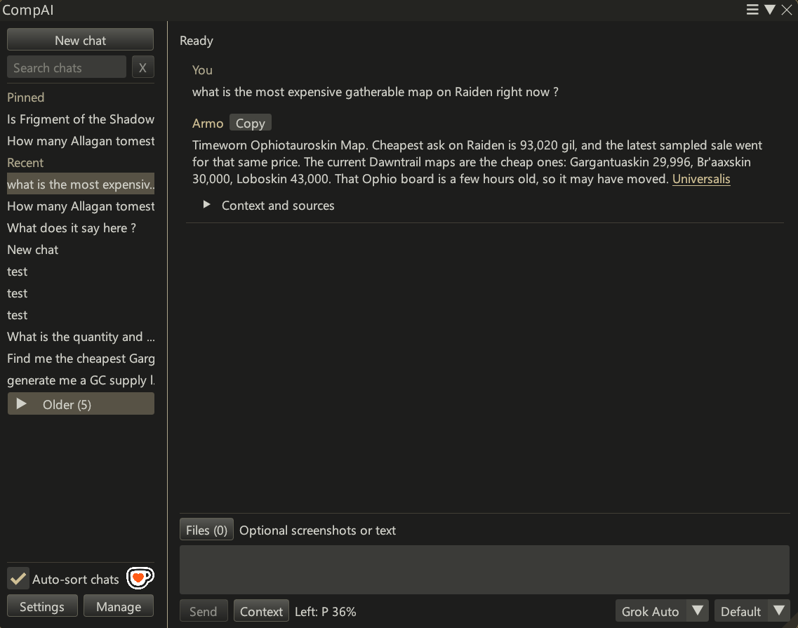
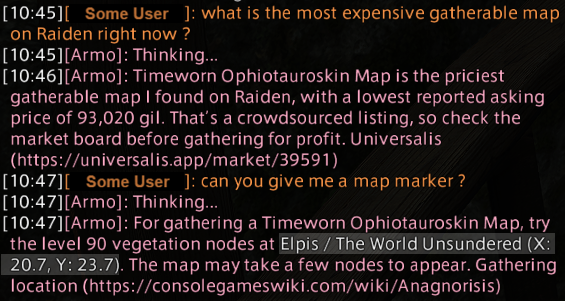
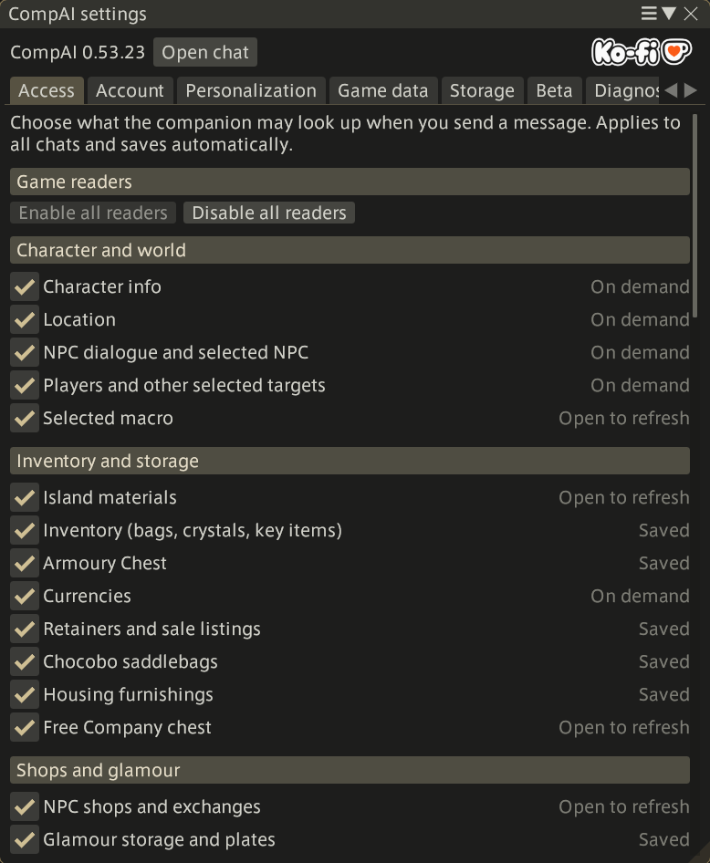

# CompAI

Ever buy crafting materials and then find a whole stack on a retainer? CompAI gives you an AI companion inside Final Fantasy XIV that you can ask about before you pull the trigger.

**[Install CompAI for Windows](INSTALL.md)** · Beta 0.53.23 · Requires XIVLauncher with Dalamud and a supported AI account.

## Try it in game

Open `/compai` to chat. Your first companion is Armo, a veteran gamer with a dry sense of humour. Prefer a neutral voice without the extra character instructions? In an open chat, select **Context → Personality** and choose **Default**. To choose who answers in new chats or create your own personality, open `/compai settings` → **Personalization**.

- “What materials do I need for a Bronze Ingot?” -> CompAI can look up recipes from the installed game.
- “Which retainer last had my Grade 8 Dark Matter?” -> Enable retainer access and visit the retainers you want it to remember.
- “Is Figments of the Shallows in my glamour dresser?” -> Enable dresser access and open your dresser to refresh what CompAI can see.

*Pick a saved chat on the left, or open **Context and sources** below a reply to see what went into the answer.*

See the follow-up in the FFXIV chat log

## You choose what it reads

All game readers start off and you can chat straight away after signing in. Open **Settings → Access** when you want an answer that uses your own game data. Some readers remember the last time you opened a menu, so revisit it if something has changed. With more readers enabled, their descriptions and lookup results can take up more room in the conversation (aka more tokens used).

Chats are saved on your PC. Pin a chat to keep it beyond 30 days of inactivity. When you send a question, your chosen cloud provider can receive the message, relevant chat history, attachments you include and results of permitted lookups. The separate **Online access** setting controls web search and public data services. AI replies still use the internet when that setting is off.

See the game access settings

These readers are enabled in this example. They start off on a fresh install.

## Choose an AI account

- **ChatGPT / Codex** -> uses your account’s Codex allowance. Compatible models support screenshots and web search.
- **Grok (Beta)** -> supports chat, text attachments and permitted game lookups. Only the Free tier has been tested. Image attachments and hosted web search are unavailable with Grok.

## Help and downloads

For installation or sign-in help, see the [install guide](INSTALL.md#troubleshooting). To report a bug, include your CompAI version, what you were doing and the short error message. [Report an issue](https://github.com/Trizor3AI/CompAI-Public/issues)

CompAI’s own code uses the AGPL-3.0-only license. The release includes matching source code, checksums and separate notices for the bundled software. [0.53.23 release files](https://github.com/Trizor3AI/CompAI-Public/releases/tag/v0.53.23.0)

CompAI is free. If you’d like to leave a tip, you can use the Ko-fi button in game or [visit Trizor3 on Ko-fi](https://ko-fi.com/trizor3).
